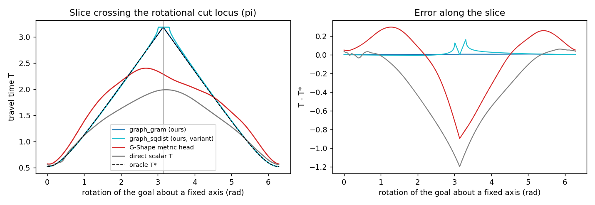
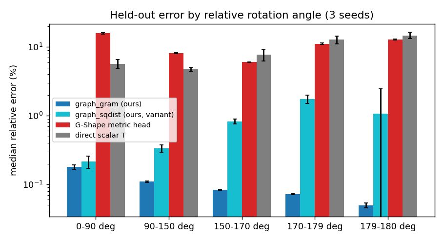

# `models/graph_method` — smooth graph travel-time fields on SE(3)

Implementation of *SE3_Smooth_Graph_Implementation.pdf* (v1.0): a network predicts
smooth latent quantities Z(x, y) = (a, b) for a start/goal pose pair, and an explicit
analytic decoder D recovers the (possibly non-smooth) travel time

    H_theta(x, y) = (G(x), G(y), Z_theta(x, y)),   G(x) = (t_x, vec R_x) in R^12
    T_theta(x, y) = D(a, b) = sqrt(a / s_t^2 + phi(b) / s_r^2),   phi(b) = 4 asin(sqrt b)^2

trained with intrinsic, separate endpoint Eikonal residuals and finite-step Bellman
targets on SE(3). The network follows the G-Shape-NTFields encoder
(`models/metric/model_network_metric.py`): random Fourier features, Lipschitz row-
normalised linear layers, sine-modulated gated residual blocks, both endpoints
through one siamese encoder. Only the pair head and the losses differ.

See `EXPERIMENTS.md` for the chronological log of every experiment (including the
failed ones). Final numbers are in the "Results" section below.

**Full report (methodology, derivations, results):** `report/report.pdf` (LaTeX source
`report/report.tex`; its tables are generated from the saved evaluation files by
`report/make_tables.py`).

## Layout (spec page 8 contract)

| spec | file | content |
|---|---|---|
| geometry/se3.py | `geometry/se3.py` | hat/vee, SO(3)/SE(3) exp & log with series near 0 and a stable near-pi log, compose, inverse, quaternions, G(x) |
| geometry/tangents.py | `geometry/tangents.py` | scaled endpoint derivatives c_x, c_y: analytic projection of the feature gradient (training) and zero-twist perturbation through exp (verification) |
| fields/oracle.py | `fields/oracle.py` | analytic latents a*, b*, independent atan2 angle oracle T*, exact geodesic path |
| fields/decoder.py | `fields/decoder.py` | domain-safe phi with series for b < 1e-3, phi', D |
| models/interface.py | `interface.py` | `predict_raw / predict_latent / decode / value / value_sq` contract |
| (architecture) | `model_network_graph.py` | G-Shape encoder + heads: `graph_gram` (proposed), `graph_metric` (stage-E hybrid: a = metric-head distance^2), `graph_sqdist`, `graph_joint` (spec's softplus/sigmoid adapter), `metric` (G-Shape metric head baseline), `scalar` (direct T baseline), `analytic` (stage A) |
| losses/eikonal.py | `losses/eikonal.py` | separate endpoint residuals, input-geometry regular mask |
| losses/bellman.py | `losses/bellman.py` | admissible finite-step targets with EMA target net, terminal "reach" action |
| data/poses.py | `data/poses.py` | deterministic 60/20/20 mixture sampler, Haar rotations, fixed held-out suites |
| planning/rollout.py | `planning/rollout.py` | gradient rollout (backtracking + sampling fallback) and 128-candidate sampling rollout on SE(3) |
| train.py | `model_train_graph.py`, `train/train_graph.py` | staged experiments, checkpoints (weights, EMA target, optimiser, sampler/RNG state, scales, exclusions, code revision) |
| evaluate.py | `evaluate.py` | field / singularity / PDE / triangle / planning metrics -> JSON + CSV + cut-locus slice plot |
| tests/ | `tests/test_graph_method.py` | 19 unit tests (geometry, decoder, gradients, losses, leakage, rollout) |
| configs/ | `configs/graph_method/*.json` | every final configuration (scales, masks, seeds, budgets) |
| (repo style) | `model_function_graph.py` | `Function`: physics / supervised / ntfields losses and queries |
| stage E | `model_function_shape.py`, `shape_adapter.py`, `scripts/run_shape_eval.py` | obstacle branch on `datasets/3dshape`, evaluated with Shape-NTFields' unmodified evaluator |

## The proposed head: `graph_gram`

Siamese encoder e(.) = [GShapeEncoder(G(.)), G(.)] (the raw embedding is appended
as a linear skip path; nothing analytic is hard-coded — the head must learn its
projections):

    a = | A (e_x - e_y) |^2                                (squared length)
    P = L L^T / |L L^T|_F,  L = reshape(W e, 4 x 4)        (unit-norm PSD Gram matrix)
    b = (1 - 1e-6) * 1/2 |P_x - P_y|_F^2  =  (1 - 1e-6)(1 - <P_x, P_y>)   in [0, 1)

Properties that hold by construction: symmetry T(x, y) = T(y, x); exact goal
values a = b = 0 and T(x, x) = 0 (boundary-exact on the diagonal); b in [0, 1]
because Gram inner products of PSD matrices are non-negative; quaternion-sign
invariance (inputs are rotation matrices). The analytic latent is representable:
b* = sin^2(theta/2) = 1 - (q_x . q_y)^2 = 1 - <q_x q_x^T, q_y q_y^T>, and
q q^T is an affine function of R. The 1e-6 margin keeps phi'(b) finite (phi' is
genuinely infinite at b = 1), so exact half-turns are representable only to
within 2e-3 rad — documented approximation, as the spec requires.

## Final training recipe (`configs/graph_method/graph_gram.json`)

Spec objective L = L_E + L_B + 10 L_goal + L_T(anchors), batch 1024, Adam 1e-3 with
cosine decay to 5e-5, 12k updates, grad clip 1, EMA target 0.995, Bellman step
h = 0.2 tau_ref with 32 admissible candidates (greedy, 15 perturbations, 16
uniform, zero), 1024 declared anchor pairs, regular-sample bands T*/tau_ref >=
1e-3 and 1 - b* >= 1e-4 (spec defaults), Fourier sigma 0.03, plus:

* **relative-angle curriculum** — training pairs (and anchors) restricted to
  relative angle <= theta_max, theta_max growing linearly from 60 to 180 deg
  over the first 7k updates. Uses input geometry only (like the masks), never
  labels. Without it physics training falls into a wrong basin (E5, E7).
* **cosine LR decay** — lr 1e-3 noise alone costs ~2 points (E6).

Deviations from the spec's suggested defaults (all tuned on validation only):
batch 1024 instead of 256 (same wall-clock cost, launch-bound), 12k instead of 20k
updates, Bellman h = 0.2 instead of a smaller step, the curriculum and the input skip.

## What is proven vs. what is empirical

Proven / verified to numerical precision (Stage A, `tests/test_graph_method.py`,
float64): the decoder applied to (a*, b*) equals the independent atan2 oracle
(< 1e-8 relative); the oracle satisfies both endpoint Eikonal equations
|c_x|^2 = |c_y|^2 = 1 (< 1e-6) away from the singular sets; the tangent
projection equals exp-perturbation autodiff and central finite differences;
the exact geodesic step is admissible for the Bellman operator; the analytic
field rolls out to the goal with cost ratio 1.00001 (gradient) / 1.012 (sampling).

Empirical (this benchmark, 3 seeds, held-out sets): everything in "Results".
Not established: convergence of sampled PDE training to the viscosity solution in
general, identifiability of (a, b) from physics losses (it happened here — latent
errors are small — but nothing forces it), triangle inequality (measured, not
guaranteed), any result among obstacles (stage E, see below).

## Results

### Stage A — analytic geometry (no learning)

`tests/test_graph_method.py`: 19/19 pass. Analytic field (`evaluate.py --analytic`, float64):
relative error ~1e-16, exact-half-turn error 9e-9, Eikonal residual 4e-16, gradient
rollout 100 % success at cost ratio 1.00001, sampling rollout 100 % at 1.012
(the 128-candidate sampling planner's own discretisation cost).

### Stages B-D — obstacle-free SE(3), held-out test set (mean ± std over seeds)

10k uniform + 10k mixture held-out pairs (seed 2002, never used for training or
model selection), dedicated singularity suites (1000 pairs each), 1000 planning
pairs with h = 0.02 tau_ref. Relative errors exclude T* < 0.05 tau_ref. "eik res"
= | |c_x|^2 - 1 | on regular pairs. Every row: same data stream, 12k updates of
batch 1024, same G-Shape encoder width/depth (~0.6 M parameters), same pose
features, speed model and planners. Physics rows use L_E + L_B + 10 L_goal +
1024 declared anchors unless stated; no row uses latent supervision except
stage B.

| model | n | uni rel p50 (%) | uni rel p95 (%) | mix rel p95 (%) | 179-180 rel p50 (%) | exact-pi abs | eik res p50 | triangle viol (%) | grad succ (%) | grad cost p50 | samp succ (%) | samp cost p50 |
|---|---|---|---|---|---|---|---|---|---|---|---|---|
| graph_gram (ours) | 3 | 0.105 ± 0.0029 | 0.313 ± 0.023 | 0.341 ± 0.028 | 0.0499 ± 0.004 | 0.00213 ± 0.00033 | 0.00413 ± 0.00049 | 0 ± 0 | 100 ± 0 | 1 ± 7.8e-06 | 100 ± 0 | 1.01 ± 4.6e-05 |
| graph_sqdist (ours, variant) | 3 | 0.405 ± 0.051 | 2.56 ± 0.21 | 3.84 ± 0.5 | 1.08 ± 1.4 | 0.0679 ± 0.023 | 0.0245 ± 0.002 | 0 ± 0 | 100 ± 0 | 1 ± 3.7e-05 | 100 ± 0 | 1.01 ± 8.2e-05 |
| metric head, best recipe | 3 | 9.53 ± 0.15 | 23.1 ± 0.14 | 24.1 ± 0.16 | 12.9 ± 0.21 | 0.455 ± 0.0099 | 0.139 ± 0.0025 | 0 ± 0 | 98.6 ± 0.21 | 1.12 ± 0.0027 | 98.6 ± 0.35 | 1.14 ± 0.0013 |
| metric head, same recipe as ours | 3 | 12.4 ± 0.15 | 35.1 ± 0.32 | 38 ± 0.24 | 26.6 ± 0.42 | 0.91 ± 0.0063 | 0.088 ± 0.001 | 0 ± 0 | 95 ± 0.61 | 1.34 ± 0.0072 | 97.5 ± 0.15 | 1.23 ± 0.0031 |
| metric head, NTFields loss | 3 | 10.5 ± 0.11 | 33.3 ± 1.3 | 31.4 ± 0.57 | 12.9 ± 0.61 | 0.453 ± 0.019 | 0.396 ± 0.0015 | 0.00333 ± 0.0058 | 92.4 ± 0.87 | 1.13 ± 0.0034 | 92.4 ± 0.55 | 1.15 ± 0.0036 |
| direct scalar T | 3 | 5.7 ± 0.51 | 22.4 ± 1.3 | 40.6 ± 2.7 | 14.8 ± 1.5 | 0.52 ± 0.048 | 0.13 ± 0.017 | 0 ± 0 | 1.43 ± 0.61 | 1.39 ± 0.004 | 1.93 ± 0.61 | 1.22 ± 0.04 |
| ours w/o curriculum | 3 | 4.01 ± 0.34 | 19.2 ± 1.1 | 21.9 ± 1.1 | 13.3 ± 1.1 | 0.482 ± 0.039 | 0.0871 ± 0.0073 | 0 ± 0 | 100 ± 0 | 1.04 ± 0.0045 | 100 ± 0 | 1.06 ± 0.005 |
| ours w/o anchors (physics only) | 3 | 2.42 ± 0.41 | 19 ± 0.33 | 18.2 ± 0.24 | 2.15 ± 0.46 | 0.128 ± 0.013 | 0.0307 ± 0.01 | 0 ± 0 | 100 ± 0 | 1.65 ± 0.24 | 99.7 ± 0.31 | 1.25 ± 0.037 |
| ours w/o input skip | 3 | 11.8 ± 0.17 | 36.3 ± 0.61 | 38.7 ± 0.92 | 27.3 ± 0.13 | 0.933 ± 0.0071 | 0.117 ± 0.00044 | 0 ± 0 | 76.2 ± 15 | 1.12 ± 0.017 | 76.3 ± 15 | 1.14 ± 0.017 |
| ours w/o Bellman | 3 | 0.0716 ± 0.008 | 0.239 ± 0.028 | 0.275 ± 0.038 | 0.0688 ± 0.007 | 0.00369 ± 0.00023 | 0.00403 ± 0.00056 | 0 ± 0 | 100 ± 0 | 1 ± 8.2e-06 | 100 ± 0 | 1.01 ± 5.7e-05 |
| ours, pi band 1e-3 | 3 | 0.165 ± 0.06 | 0.36 ± 0.052 | 0.377 ± 0.044 | 0.1 ± 0.035 | 0.00358 ± 0.0025 | 0.00325 ± 0.00068 | 0 ± 0 | 100 ± 0 | 1 ± 6.9e-06 | 100 ± 0 | 1.01 ± 7.2e-05 |
| stage B supervised (labels) | 1 | 0.026 | 0.0843 | 0.0975 | 0.0693 | 0.00395 | 0.00162 | 0 | 100 | 1 | 100 | 1.01 |




Findings (empirical, this benchmark):

* **The smooth-graph field is ~90x more accurate than the G-Shape metric head
  under identical data/budget/planner** (median relative error 0.105 % vs 9.5 %,
  p95 0.31 % vs 23 %), and plans optimally (100 % success, cost ratio 1.000 vs
  98.6 % / 1.12). It meets the spec's provisional gates (median < 1 %, p95 < 5 %,
  success >= 99 %) on all three seeds.
* **Mechanism confirmed at the cut locus:** the learned b stays smooth and the
  decoder reproduces the corner of T at the half-turn (exact-pi error 0.002); its
  error *decreases* toward 180 deg, while the metric head and the direct scalar
  network round the corner off (errors 13-15 % at 179-180 deg).
* Physics losses recovered the analytic latents without latent supervision
  (b error ~4e-4) — identifiability was observed, not guaranteed.
* Required ingredients (ablations): the relative-angle curriculum (without: 4.0 %),
  the linear input skip (without: 11.8 %), and the declared anchors (without:
  2.4 % median, 19 % p95 — see E10 for the projection-metric degeneracy behind this).
* The Bellman term, as configured, slightly *hurts* final accuracy here
  (0.072 % without vs 0.105 % with); it is kept in the main row because the spec
  objective includes it. The direct scalar network cannot be planned on with the
  gradient planner (1.4 % success): without an exact zero at the goal its
  minimum is offset.

### Stage E — obstacles (separate research branch; Tshape3d_env1)

Spec page 6: only after A-D pass; the two-output decoder no longer implies
smooth targets or physical meanings for a, b. Everything here is empirical.

Setup: `datasets/3dshape/Tshape3d_env1` (800k pose pairs with clearance speeds),
declared position-dependent ellipsoidal speed model with s_t = 1, s_r = 2 pi
(rotations in turns, as in the baseline), isotropic multiplier = the dataset's
combined speed after the baseline warp s^2 (2-s)^2; separate endpoint Eikonal
(baseline sqrt residual form) weighted by exp(-0.5 T) with non-detached T (as
in NTFields); no anchors, no Bellman term (the baseline has TD off), AdamW
(wd 0.5, lr 5e-4), batch 2000, 20k updates; Fourier sigma_t 0.5 / sigma_r 0.1
for both heads (`configs/graph_method/stageE_common.json`). Planning is scored by
the **unmodified** Shape-NTFields `evaluate_training_3d_batched.py` (MPPI,
collision-checked) on the 1000 RRT-verified test cases, through
`shape_adapter.py` / `scripts/run_shape_eval.py`.

**Tshape3d_env1, all 1000 test cases** (MPPI success by planner variant; failure counts
for the forward planner; mean ± std over seeds):

| model | seeds | cases | forward (%) | reverse (%) | either (%) | alternate (%) | collision | no-converge |
|---|---|---|---|---|---|---|---|---|
| metric NTFields baseline (native pipeline, reference) | 2 | 1000 | 81.2 ± 1.3 | 80.0 ± 0.1 | 91.1 ± 0.8 | 88.6 ± 0.4 | 117.5 ± 6.4 | 139.0 ± 14.1 |
| metric head (G-Shape), our pipeline | 3 | 1000 | 80.0 ± 0.6 | 80.1 ± 0.4 | 87.2 ± 0.2 | 82.1 ± 0.9 | 18.7 ± 6.0 | 188.3 ± 1.2 |
| graph_metric (graph latents, metric-type a) | 3 | 1000 | 79.2 ± 0.2 | 80.8 ± 0.1 | 87.3 ± 0.2 | 82.5 ± 0.7 | 20.0 ± 6.0 | 194.0 ± 3.6 |
| graph_gram (Euclidean a) | 3 | 1000 | 75.1 ± 0.4 | 76.2 ± 0.5 | 85.8 ± 0.3 | 80.0 ± 0.8 | 74.7 ± 10.0 | 200.3 ± 3.5 |
| graph_gram with k_a 128 | 1 | 1000 | 74.2 | 74.6 | 84.8 | 80.1 | 84.0 | 196.0 |

**Lshape3d_env3, all 1000 test cases (graph_gram 1 seed, others 2 seeds):**

| model | seeds | cases | forward (%) | reverse (%) | either (%) | alternate (%) | collision | no-converge |
|---|---|---|---|---|---|---|---|---|
| metric head (G-Shape), our pipeline | 2 | 1000 | 81.4 ± 0.4 | 81.2 ± 1.1 | 86.8 ± 0.2 | 83.8 ± 0.8 | 18.0 ± 4.2 | 174.0 ± 2.8 |
| graph_metric (graph latents, metric-type a) | 2 | 1000 | 82.9 ± 0.7 | 83.2 ± 0.1 | 88.8 ± 0.1 | 84.5 ± 0.6 | 17.0 ± 2.8 | 159.5 ± 9.2 |
| graph_gram (Euclidean a) | 1 | 1000 | 70.3 | 72.2 | 82.2 | 80.6 | 39.0 | 277.0 |

**Ashape3d_env4, all 1000 test cases (graph_gram 1 seed, others 2 seeds):**

| model | seeds | cases | forward (%) | reverse (%) | either (%) | alternate (%) | collision | no-converge |
|---|---|---|---|---|---|---|---|---|
| metric head (G-Shape), our pipeline | 2 | 1000 | 81.5 ± 1.1 | 81.2 ± 0.4 | 87.3 ± 0.1 | 83.5 ± 0.1 | 18.0 ± 0.0 | 173.0 ± 8.5 |
| graph_metric (graph latents, metric-type a) | 2 | 1000 | 81.5 ± 0.8 | 80.6 ± 1.4 | 87.5 ± 0.1 | 83.4 ± 0.6 | 22.5 ± 4.9 | 170.5 ± 4.9 |
| graph_gram (Euclidean a) | 1 | 1000 | 75.6 | 75.3 | 84.9 | 82.3 | 50.0 | 211.0 |

Mean forward success over the three environments (same pipeline, seed means):
graph_metric 81.2 %, metric head 81.0 %, graph_gram 73.7 %. For reference, the Lie-Shape-NTFields
research notes report the native metric baseline at 87.7-91.6 % (L) and
85.9-88.9 % (A); the native pipeline's lead is larger on these two environments
than on the T-shape, and applies to both heads trained in our pipeline.

Findings (empirical):

* With an identical pipeline, the **graph method with a metric-type a-latent
  (`graph_metric`) is on par with the G-Shape metric head**: T-shape 79.2 ± 0.2 vs
  80.0 ± 0.6 % forward (equal or better on the reverse / either / alternate
  planners), L-shape 82.9 ± 0.7 vs 81.4 ± 0.4 %, A-shape 81.5 ± 0.8 vs
  81.5 ± 1.1 %.
* The obstacle-free winner `graph_gram` is ~5 points behind among obstacles
  (75.1 ± 0.4 %); widening its Euclidean a-latent to 128 dims does not help
  (74.2 %). Euclidean a-latents encode the free product metric exactly but are
  a poor prior for obstacle geodesics; conversely `graph_metric` is only
  metric-baseline-level obstacle-free (8.7 % median error). No single head wins
  both settings.
* The metric head inside our intrinsic pipeline matches the native baseline
  within ~1-2 points (80.0 vs 81.2 % on the same machine); the native pipeline
  remains 2-4 points ahead of every head here and fails differently (more
  collisions, fewer non-convergences). The remaining gap was not attributable
  to rollback, gradient clipping, the regular-sample mask or Fourier sampling
  (E12-E13).

Reference: the metric NTFields baseline in its native pipeline scores 82.1 % / 80.3 %
(seeds 1, 2; same evaluator and test set; 5-seed mean 81.9 ± 0.5 per the
Lie-Shape-NTFields research notes); re-scored here on the first 200 cases: 82.0 %.

What mattered (E9-E13): the NTFields non-detached exp(-0.5 T) weighting (0-1 % ->
22 %), the input skip (6 % -> 22 %), and above all the rotation Fourier frequency
(sigma_r 0.3 -> 0.1: 22 % -> 67-69 %; G(x) contains vec R, whose phase per radian is
~3x that of the baseline's rotation-vector input). Anisotropic speeds hurt
(11 %); a speed lower bound T >= T_free did not help (70.5 %).


## Reproduce

All commands run inside the `pytorchserver:latest` image from the repo root
(`docker run --gpus all -u $(id -u):$(id -g) -e HOME=/tmp -v $PWD:/workspace -w /workspace pytorchserver:latest ...`).

```bash
python -m unittest tests.test_graph_method                       # stage A
python -m models.graph_method.evaluate --analytic --out results/graph_method/analytic
python train/train_graph.py --config configs/graph_method/graph_gram.json --seed 0 \
    --out_root ./Experiments/graph_method_final                   # -> graph_gram_s0
python -m models.graph_method.evaluate --ckpt Experiments/graph_method_final/graph_gram_s0/best.pt \
    --out results/graph_method_final/graph_gram_s0
python models/graph_method/scripts/aggregate.py results/graph_method_final \
    --groups graph_gram='graph_gram_s*' metric='metric_best_recipe_s*'
python models/graph_method/scripts/make_figures.py --exp Experiments/graph_method_final \
    --res results/graph_method_final --out results/graph_method_final/figures

# stage E (obstacles): train, then score with Shape-NTFields' unmodified evaluator
# (mount Shape-NTFields read-only at /shape)
python train/train_graph.py --config configs/graph_method/stageE_common.json --seed 0 \
    --name stageE_graph_metric_s0 --out_root ./Experiments/graph_method_stageE \
    --set fourier_sigma_t=0.5 fourier_sigma_r=0.1 arch="'graph_metric'" skip_input=True
python models/graph_method/scripts/run_shape_eval.py /shape /workspace \
    --dataPath testing_data/3dshape/Tshape3d_env1 --no-viser --cases 0 \
    --checkpoint /workspace/Experiments/graph_method_stageE/stageE_graph_metric_s0/latest.pt \
    --out /workspace/results/graph_method_stageE/stageE_graph_metric_s0_c1000
```
